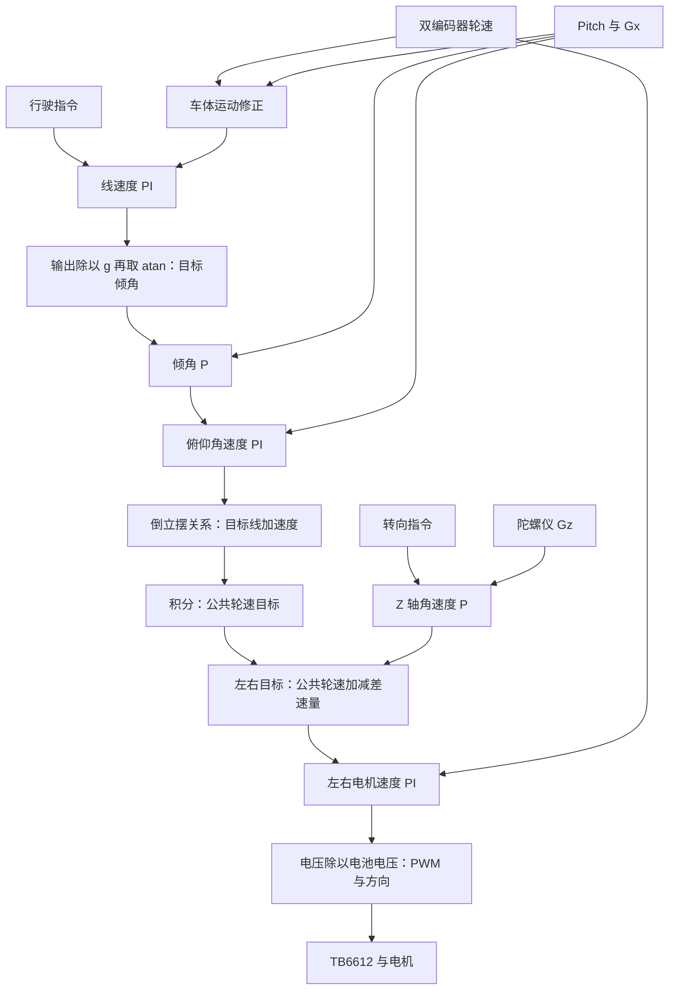

# Blance_Car · STM32 两轮自平衡车

基于 **STM32F103C8、标准外设库和裸机轮询**的两轮平衡车固件。项目通过 IMU 获取倾角和角速度，通过增量编码器获取轮速，使用串级控制生成轮速目标，再由左右电机速度闭环驱动 TB6612。USART3 接收行驶与转向命令，USART2 用于独立测试和波形观察。

项目名称保留原工程 `Blance_Car` 拼写。本文以当前仓库源码和 `Blance_Car.uvprojx` 为依据，介绍项目功能、硬件接口、软件结构、控制原理及构建调试方法。

> 项目基于成品套件及教程开展，通用组件保留了原作者署名。本文中的控制周期和硬件参数以代码配置为依据，实际时序、控制误差和整车表现需通过板级测试确认。

## 目录

- [功能与实现范围](#功能与实现范围)
- [仓库结构与阅读路线](#仓库结构与阅读路线)
- [硬件接口与资源分配](#硬件接口与资源分配)
- [启动、调度与中断](#启动调度与中断)
- [控制链路与公式](#控制链路与公式)
- [编码器测速与滤波](#编码器测速与滤波)
- [IMU 与姿态融合](#imu-与姿态融合)
- [电机、PWM、电池与按键](#电机pwm电池与按键)
- [遥控协议与数据交接](#遥控协议与数据交接)
- [构建、下载与调试](#构建下载与调试)
- [已知边界与改进顺序](#已知边界与改进顺序)
- [资料与版权](#资料与版权)

## 功能与实现范围

| 功能 | 当前实现 | 源码入口 |
| --- | --- | --- |
| 平衡与行驶 | 速度→倾角→俯仰角速度串级控制，模型换算为轮速目标 | [app_control.c](user/app_control.c) |
| 差速转向 | Z 轴角速度反馈，左右目标分别加、减差速量 | [app_control.c](user/app_control.c) |
| 双电机调速 | 左右独立 PI，输出电压按电池电压换算为 PWM | [app_motor.c](user/app_motor.c) |
| 编码器反馈 | A 相双边沿 EXTI，读取 B 相判向；T 法测速与 EMA | [app_encoder.c](user/app_encoder.c) |
| 姿态估计 | 加速度倾角与陀螺积分互补滤波；Yaw 仅积分 | [app_mpu6050.c](user/app_mpu6050.c) |
| 遥控 | USART3 中断收行，主循环解析 `move` 命令 | [app_rc.c](user/app_rc.c) |
| 电压检测 | TIM2 TRGO 触发 ADC1 注入转换，JEOC 中断更新电压 | [app_bat.c](user/app_bat.c) |
| 电机使能 | 按键单击切换 STBY，同时复位部分控制状态 | [app_button.c](user/app_button.c) |
| 波形测试 | USART2 输出逗号分隔文本，供 VOFA+ 等工具观察 | [test/](test/) |

本工程没有 FreeRTOS 任务、卡尔曼滤波、DMP 姿态解算、ADC DMA 采样或位置闭环。库目录存在 DMA、CAN 等驱动，不表示应用启用了这些外设。USART2 在正常主程序中只初始化，持续波形发送来自手动选择的测试入口。

## 仓库结构与阅读路线

```text
Blance_Car/
├── user/                     主程序、应用模块、系统时钟与异常处理
│   ├── main.c                初始化顺序与协作式主循环
│   ├── app_control.c         平衡、行驶、转向控制
│   ├── app_motor.c           左右电机速度 PI
│   ├── app_encoder.c         EXTI、角度换算、T 法和 EMA
│   ├── app_mpu6050.c         IMU 配置、原始数据和互补滤波
│   ├── app_pwm.c             TB6612 方向、STBY 和 PWM
│   ├── app_rc.c              USART3 遥控接收及解析
│   ├── app_bat.c             电压采样与电量 LED
│   ├── app_button.c          按键回调与使能
│   └── app_usart2.c          调试串口配置
├── my_lib/                   PID、时间、通信、按键、快速数学和显示组件
├── test/                     手动选择的板级测试程序
├── std_periph_driver/        STM32F10x 标准外设库与 CMSIS 头文件
├── startup/                  多种容量型号的启动文件
├── DebugConfig/              Keil 调试配置
├── Blance_Car.uvprojx         Keil 工程
└── README.md
```

建议先读 `main.c`，沿 `app_control.c → app_motor.c → app_pwm.c` 理解输出，再读传感器模块和 `pid.c` 理解反馈，最后检查 `task.h`、`delay.c`、`app_rc.c` 的调度与并发。

| 通用组件 | 作用与当前接入情况 |
| --- | --- |
| [pid.c](my_lib/pid.c)、[pid.h](my_lib/pid.h) | 位置式 PID；当前控制器配置实际为 P/PI |
| [task.h](my_lib/task.h)、[delay.c](my_lib/delay.c) | 周期判断、SysTick 时间和忙等待延时 |
| [i2c.c](my_lib/i2c.c) | 硬件 I²C 轮询通信，IMU 使用此路径 |
| [button.c](my_lib/button.c) | 非阻塞按键状态机、消抖、多击和长按回调 |
| [qmath.c](my_lib/qmath.c) | 查表三角函数、二分查找反三角函数；仍使用浮点运算 |
| [usart.c](my_lib/usart.c) | 轮询收发、格式化输出，主要用于测试 |
| [si2c.c](my_lib/si2c.c)、[spi.c](my_lib/spi.c) | 软件 I²C、SPI 组件，正常平衡链路未调用 |
| [oled.c](my_lib/oled.c)、字体资源 | SSD1306 类显示、图形与文本组件，主程序未初始化 OLED |
| `str_cmd.c`、`str_cmd.h` | 当前均为空文件；遥控解析直接写在 `app_rc.c` 中 |

`my_lib/font/` 包含字体转换程序和字体二进制资源，不属于 MCU 控制逻辑。`Objects/`、`Listings/`、`.vscode/`、Keil 用户配置等已由 `.gitignore` 排除。启动目录有多个版本，工程实际选择 `startup_stm32f10x_md.s`。

## 硬件接口与资源分配

### 源码可核实的引脚

| 模块 | MCU 引脚 | 外设/配置 |
| --- | --- | --- |
| IMU SCL / SDA | PB8 / PB9 | I²C1 重映射，复用开漏，配置 400 kHz |
| TB6612 STBY | PA1 | 推挽输出，高电平使能 |
| 左电机方向 | PA9 / PA10 | AIN1 / AIN2 |
| 左电机 PWM | PA8 | TIM1_CH1，PWM1 |
| 右电机方向 | PB5 / PB7 | BIN1 / BIN2 |
| 右电机 PWM | PB6 | TIM4_CH1，PWM1 |
| 左编码器 A / B | PB14 / PB15 | 上拉输入，A 相 EXTI14 双边沿 |
| 右编码器 A / B | PB3 / PB4 | 上拉输入，A 相 EXTI3 双边沿；关闭 JTAG，保留 SWD |
| 电池电压 | PB0 | ADC1 通道 8，注入序列，TIM2 TRGO 触发 |
| 电量 LED | PA4 / PA5 / PA6 | 推挽输出 |
| 用户按键 | PA11 | 上拉输入，低电平按下 |
| 遥控 TX / RX | PB10 / PB11 | USART3，9600 bps，8N1 |
| 调试 TX / RX | PA2 / PA3 | USART2，921600 bps，8N1 |

### 时钟与定时器

[system_stm32f10x.c](user/system_stm32f10x.c) 选择 72 MHz 配置，非互联型芯片路径为 HSE × 9；标准头文件默认 HSE 为 8 MHz。正常配置下 HCLK/PCLK2 为 72 MHz，PCLK1 为 36 MHz。APB1 分频不为 1 时，对应定时器时钟倍频，因此 TIM2、TIM4 的计算基准仍为 72 MHz。

| 资源 | 配置 | 正常时钟条件下的推算 |
| --- | --- | --- |
| SysTick | 根据 HCLK 设置重装值 | 毫秒计数；`GetUs()` 结合当前计数值换算微秒 |
| TIM1 / TIM4 | PSC=0，ARR=999 | PWM 频率 `72 MHz / 1000 = 72 kHz` |
| TIM2 | PSC=71，ARR=9999，Update TRGO | 每 10 ms 触发 ADC 注入转换 |
| ADC1 | PCLK2 / 6 | ADC 时钟 12 MHz，采样时间配置为 1.5 周期 |

以上为寄存器推算值，实际频率应测量验证。工程 XML 中 `CLOCK(12000000)` 字段不能替代运行时系统时钟代码。

### 历史硬件记录与证据边界

原 README 记录实际 IMU 为 **MPU-6500**、驱动器为 **TB6612FNG**、电机为 **GA25-170**，编码器为 11 对极，实测减速比约 20.4087:1。当前代码仍沿用 `MPU6050` 命名，温度公式和注释采用 6500 写法；本版本没有读取 `WHO_AM_I`，不能仅凭函数名确认实物型号。

旧说明还记录两串电池、MT2492 降压、5.1 kΩ/3.3 kΩ 分压和 RGB 接口。当前仓库没有对应原理图、BOM、芯片照片或标定数据，以上内容应作为历史接线参考与实物复核。原文提到的 `平衡车电路图.pdf`、`C8T6引脚分布.xlsx`、`MPU6500寄存器.pdf`、`完整源码.rar` 和机械模型均未包含在当前仓库中，不作为克隆后的必备文件或已实现功能依据。

## 启动、调度与中断

### 初始化与执行顺序

启动文件设置栈、向量表，经 `SystemInit()` 和 C 运行库初始化后进入 `main()`。当前启动文件声明栈和堆各 `0x1000` 字节，实际链接占用应查看当次 map 文件。

`main()` 初始化顺序：USART2 → 按键 → 编码器 → PWM → 电池采样 → 电机 PI → IMU → 平衡控制 → USART3 遥控。IMU 复位包含 `Delay(100)`，时间模块在首次调用时初始化 SysTick。

```text
主循环：按键 → 电量指示 → 电机速度闭环 → IMU 更新 → 平衡/转向控制 → 遥控解析
```

电机处理在平衡处理之前，因此当次电机运算使用此前设置的轮速目标；这不是统一采样和统一提交输出的同步流水线。

### 周期宏的真实语义

[task.h](my_lib/task.h) 的核心实现为：

```c
#define PERIODIC(T) \
static uint32_t nxt = 0; \
if(GetTick() < nxt) return; \
nxt += (T);
```

| 模块 | 名义间隔 | 位置 |
| --- | --- | --- |
| 电机速度环 | 1 ms | 主循环 `App_Motor_Proc()` |
| IMU 融合 | 5 ms | 主循环 `App_MPU6050_Proc()` |
| 平衡与转向 | 5 ms | 主循环 `App_Control_Proc()` |
| 电压转换 | 10 ms | TIM2 硬件触发，不由周期宏调度 |
| 按键、LED、遥控 | 每轮检查 | 主循环，各自再判断状态或时间 |

这是协作式周期判断，没有任务抢占、独立线程或严格实时保证。I²C 等待、串口解析和长中断会推迟后续模块。

`nxt` 从 0 开始，每次只累加一个周期。初始化已过去约 100 ms 时，周期函数可能连续执行以追赶时间；运行过载也可能补跑。绝对大小比较还没有处理 32 位毫秒计数约 49.7 天后的回绕。应表述为“配置 1/5 ms 名义间隔”，不能直接说“实测严格 1/5 ms”。

### 中断职责与优先级

| 中断 | 文件 | 职责 |
| --- | --- | --- |
| `SysTick_Handler` | `user/stm32f10x_it.c` | 按 COUNTFLAG 更新 `ulTicks` |
| `EXTI3_IRQHandler` | `user/app_encoder.c` | 右编码器时间戳、方向、计数 |
| `EXTI15_10_IRQHandler` | `user/app_encoder.c` | 左编码器 EXTI14 数据更新 |
| `ADC1_2_IRQHandler` | `user/app_bat.c` | 读取 JDR1，换算电压 |
| `USART3_IRQHandler` | `user/app_rc.c` | 接收字符，换行时交接字符串 |

`NVIC_PriorityGroup_0` 表示 **0 位抢占优先级、4 位子优先级**，依据为仓库 `misc.h` / `misc.c`，部分应用注释写反了。编码器和 USART3 子优先级为 0，ADC 为 2；子优先级决定同时挂起时的服务顺序，不能据此认为编码器可抢占正在执行的 ADC ISR。

## 控制链路与公式

### 总体结构



共有六个控制器实例：速度、倾角、俯仰角速度、转向、左电机速度、右电机速度。“三环串级”指前三个平衡控制环，转向与执行器速度闭环需要单独说明。

### 反馈与模型换算

代码参数：`g=9.81 m/s²`，质心到轮轴距离 `lp=0.062 m`，轮胎半径 `rw=0.032 m`。以下对应 `App_Control_Proc()`，角度为 rad，角速度为 rad/s：

```text
ω          = (ωL + ωR) / 2
θ          = Pitch × π/180
θdot       = Gx × π/180
ω2         = -θdot × (lp + rw) / rw
xdot       = (ω - ω2) × rw

θref       = qatan(PI_velocity(vref - xdot) / g)
θdot_ref   = P_theta(θref - θ)
θddot_ref  = PI_theta_dot(θdot_ref - θdot)
xddot_ref  = (g × qsin(θ) - θddot_ref × lp) / qcos(θ)
ωref       = ωref + xddot_ref / rw × Δt

diff       = P_turn(turn_ref - Gz × π/180)
ωL_ref     = ωref + diff
ωR_ref     = ωref - diff
```

`xdot` 不只是平均轮速乘轮径，还按代码坐标加入车体俯仰运动修正。速度控制输出先除以 `g` 再取 atan，可按加速度型控制量理解；部分源码单位注释与换算不一致，应以公式为准。

模型不包含完整电机电气特性、轮胎滑移或复杂惯量耦合；`qcos(θ)` 接近 0 时数值敏感。当前没有倾倒角度保护和分母保护。公共轮速目标 `ωref` 持续积分且未单独限幅，上游 PID 限幅不等于轮速目标有完整约束。

转向量在左右分别加减，故左右目标差为 `2×diff`。代码没有使用轮距建立完整差速运动学关系，不能把 `diff` 直接等同于车体偏航角速度。

### 当前参数

| 控制器 | Kp | Ki | Kd | 输出限制 | 用途 |
| --- | ---: | ---: | ---: | --- | --- |
| 线速度 | 10 | 1 | 0 | ±4.905 | 除以 g 再取 atan；目标倾角约 ±26.6° |
| 倾角 | 4 | 0 | 0 | ±12.57 | 目标俯仰角速度，rad/s |
| 俯仰角速度 | 10 | 10 | 0 | ±125.7 | 目标俯仰角加速度，rad/s² |
| 转向 | 1 | 0 | 0 | ±15 | 左右轮速加减量，rad/s |
| 左电机速度 | 0.5 | 7 | 0 | ±8.4 | 电压控制量，V |
| 右电机速度 | 0.5 | 7 | 0 | ±8.4 | 电压控制量，V |

这些是当前配置，不是对所有车架成立的通用参数。轮径、重心、电机、供电和安装变化后，需要重新检查模型和闭环参数。

### PID 离散实现

[PID_Compute()](my_lib/pid.c) 使用位置式 PID：

```text
e(k) = SP - FB
Δt   = (GetUs() - 上次时间戳) × 10⁻⁶
D    = [e(k) - e(k-1)] / Δt
I    = I(k-1) + [e(k) + e(k-1)] × Δt / 2
u    = Kp × e(k) + Ki × I + Kd × D
```

积分采用梯形法，微分采用误差差分，首次计算跳过积分和微分。输出限幅后，保存的误差积分也按同一上下限裁剪。

误差积分与输出的量纲不同，复用限制只是简化处理；输出饱和后仍积分，不是完整的条件积分或反算抗饱和。函数没有 `Δt=0` 保护，追赶式调度可能导致间隔很短甚至微秒计时相同。当前全部 Kd 为 0，但通用函数仍执行微分计算路径。

## 编码器测速与滤波

### 计数、方向与单位

编码器只在 A 相上升沿和下降沿中断，再读取 A/B 电平关系判向。这是 A 相二倍频，不是 A/B 双相四倍频，也没有使用定时器 Encoder Interface。

左右轮安装相反，源码对相同 A/B 电平关系使用相反计数符号，以统一车辆前进时的轮速方向；实车仍应核验 PWM 与反馈正方向一致。

```text
每电机轴转计数    = 22
减速比           = 30613 / 1500 ≈ 20.4087
每车轮轴转计数 N = 22 × 20.4087 ≈ 448.991
位置角度          = 累计计数 / N × 360°
```

“22”与旧硬件说明的“11 对极×A 相双边沿”一致，源码只能证实使用这些常量。换电机后，应重新标定车轮整圈计数，分清电机轴与输出轴。

### T 法运行测速

ISR 记录最新两个边沿时间 `t0`、`t1`，主循环取快照后计算：

```text
T = max(t0 - t1, now - t0) × 10⁻⁶
ωraw = direction × 2π / (N × T)
```

低速时固定 1 ms 窗口内常无新脉冲，M 法易出现零值与跳变；T 法利用脉冲间隔适合低脉冲密度。这里取两种时间的较大值，使停止后的速度逐渐衰减，而不是保持最后一次速度；没有明确停止超时归零阈值。

换向时 `direction` 暂时标记为 ±2，测速返回 0 并清滤波状态；下一同向边沿恢复 ±1，避免用跨换向间隔计算。初始化没有显式检查有效边沿数或 `T>0`，需要补强。

### EMA 及 Getter 副作用

```text
ωfiltered(k) = 0.1 × ωraw(k) + 0.9 × ωfiltered(k-1)
```

系数越小通常越平滑，但滞后增大。固定采样下可用 `α=1-exp(-Δt/τ)` 设计时间常数；本实现固定 `α=0.1`，且每次调用测速 Getter 都更新滤波状态。

电机环和速度外环都会调用 Getter，因此实际更新次数取决于调用路径，不完全等于一个固定采样周期。更清晰的改法是定时采样、滤波并缓存，Getter 只读结果。

### 共享数据与临界区

方向、计数和时间戳声明为 `volatile`，但它不保证原子性和多字段一致性。Cortex-M3 上不能把 64 位读写视为单条原子访问，测速函数通过短暂关中断复制方向和时间戳，再到临界区外计算。

位置 Getter 直接读 64 位计数，没有同样保护。现有临界区和 `GetUs()` 使用直接关闭/开启中断，没有保存和恢复调用前的 PRIMASK，不适合作为任意可嵌套的临界区工具。

## IMU 与姿态融合

### 寄存器与通信

| 配置 | 写入/读取 | 当前含义 |
| --- | --- | --- |
| `0x6B` | 写 `0x80`，延时后写 `0x00` | 复位并唤醒 |
| `0x1B` | 写 `0x18` | 陀螺仪 ±2000°/s |
| `0x1C` | 写 `0x00` | 加速度计 ±2g |
| `0x3B–0x48` | 逐字节读取 | 三轴加速度、温度、三轴角速度 |

高低字节合并为 `int16_t`。加速度乘约 `1/16384` 转为 g，陀螺仪乘约 `1/16.384` 转为 °/s；温度公式为 `raw/333.87+21`，注释注明 6500。

驱动传入 `0xD0` 是左对齐地址，对应七位地址 `0x68`，底层再设置读写位。移植到接受七位地址的 API 时应核对约定。

`reg_read()` 先发送寄存器地址，再单字节接收，分为两个事务；当前没有使用库中 `My_I2C_RegReadBytes()` 的重复起始批量读取路径。14 字节分开读取增加总线开销，也不能保证高低字节及各轴来自同一个采样时刻。改为连续读取时仍需验证底层多字节接收时序。

### 互补滤波

```text
pitch_g = pitch + gx × 0.005
roll_g  = roll - gy × 0.005
yaw_g   = yaw + gz × 0.005
pitch_a = qatan2(ay, az) × 180/π
roll_a  = qatan2(ax, az) × 180/π

pitch = 0.95238 × pitch_g + 0.04762 × pitch_a
roll  = 0.95238 × roll_g  + 0.04762 × roll_a
yaw   = yaw_g
```

陀螺仪短期响应快，但零偏经积分会累积；加速度计利用重力提供长期倾角参考，但会受到运动加速度和振动影响。若用常见 `α=τ/(τ+Δt)` 解释系数，在 5 ms 下对应 `τ≈0.1 s`，这是公式推算，不是实测频响。

Pitch 使用 `gx` 和 `ay/az`，Roll 使用 `-gy` 和 `ax/az`，体现安装坐标约定。Yaw 无磁力计等绝对航向参考，会漂移；转向环反馈 Gz 而非 Yaw，不能称为航向保持。

姿态积分固定使用 5 ms，PID 和公共轮速积分使用实际时间间隔，周期抖动及补跑时两者可能不一致。当前没有身份识别、静止零偏校准、显式 DLPF/采样率配置或参数持久化。

### I²C 故障路径

底层存在无超时的 BUSY/SB/RXNE 等等待。部分路径返回错误码，但 IMU 上层没有检查，失败读取可能继续使用未可靠赋值的数据。故障可能阻塞整个协作式主循环；改进应包含超时、总线恢复、有效数据标志和失效停机。

## 电机、PWM、电池与按键

### 电压到 PWM

```text
duty(%) = ua / vbat × 100
CCR     = abs(duty) / 100 × 999
```

左右电机 PI 输出请求电压，符号决定方向，绝对值决定 PWM。除以电池电压可近似减轻供电变化影响；它不是电流闭环，也没有电流测量。

TIM1 是高级定时器，开启 MOE 主输出；TIM4 初始化也调用 `TIM_CtrlPWMOutputs()`，但不能据此称 TIM4 有同样的高级定时器 MOE 功能，后续应复核该调用适用范围。

100% 输入给出 CCR=999，在 1000 个计数周期中约为 99.9%。函数注释标注 ±100%，实现没有实际夹紧。电池低于 8.4 V 时，PI 电压限幅仍不能保证占空比不超 100%；也没有电池为 0 或异常时的除数保护。

### ADC 与电量指示

链路：TIM2 Update → TRGO → ADC1 注入通道 8 → JEOC ISR → `vbat`。不是主循环主动转换，也不是 DMA。

```text
vbat = JDR1 / 4095 × 3.3 × 8.4 / 3.3
     = JDR1 / 4095 × 8.4
```

换算将 ADC 满量程映射为电池 8.4 V，隐含固定参考电压和分压比例。应检查电阻误差、VDDA、ADC 校准及采样时间；当前应用没有显式 ADC 校准流程，1.5 周期是否合适需结合源阻抗验证。

| 电压判断（按顺序） | LED |
| --- | --- |
| `vbat > 7.5 V` | 三灯亮 |
| `vbat > 7.4 V` | 两灯亮 |
| `vbat > 7.0 V` | 一灯亮 |
| `vbat > 6.5 V` | 三灯灭 |
| 其余情况，含 `6.5 V` | 每 100 ms 翻转全部 LED，完整闪烁周期约 200 ms |

这是电压分段显示，不是精确剩余电量算法。低压只改变 LED，没有自动关闭 STBY。

### 按键与复位

通用按键库用状态机做 10 ms 消抖，没有用延时阻塞主循环。释放后等待超过 200 ms 的多击窗口再报告点击次数。应用只处理单击，切换 STBY，调用平衡控制复位和电机 PI 复位。

`App_Control_Reset()` 清除公共轮速、时间戳和三个平衡环历史，但没有复位转向环，也没有清零行驶/转向设定值。STBY 关闭期间控制仍运行，状态仍可积累。按键切换不能等同完整停机状态机或紧急停止。

## 遥控协议与数据交接

USART3：9600 bps，8N1，LF（`\n`）结束。推荐小写命令：

```text
move <turnspeed> <movespeed>\n
```

参数解析为整数，按百分比尺度映射：

```text
目标线速度   = -movespeed × 0.01 × 0.7  m/s
目标转向速度 = -turnspeed × 0.01 × 15   rad/s
```

| 命令 | 数值结果 |
| --- | --- |
| `move 0 0` | 两个目标为 0，不关闭驱动 |
| `move 0 50` | 线速度目标 -0.35 m/s，转向 0 |
| `move 20 0` | 转向目标 -3 rad/s，线速度 0 |

方向应结合实车验证。0.7 m/s、15 rad/s 是 ±100 输入下的映射尺度，代码未检查参数范围，所以不是强制上限。

```text
ISR 收字符 → intBuf
遇 LF 后 strcpy → transBuf，设置 lineReceivedFlag
主循环 strcpy → procBuf，再 sscanf 解析
```

三个缓冲区均为 64 字节，但存在以下边界：

- 未检查游标，最多只能容纳 63 个非换行字符和一个结束符；超长行会越界。
- ISR 可在主循环复制 `transBuf` 时覆盖它，清标志也可能丢新通知；三缓冲和 `volatile` 标志不是可靠队列。
- 解析在新行分支之外，旧命令每轮都会重复解析。
- 前缀判断忽略大小写，后续 `sscanf` 的小写字面量匹配仍区分大小写，处理不统一。
- 没有参数限幅、校验、应答、断联超时停车或 USART 错误恢复；一次命令的目标持续保留。

## 构建、下载与调试

### 工程配置与复现

| 项目项 | 仓库记录 |
| --- | --- |
| 工程 | `Blance_Car.uvprojx` |
| Target | `default`，器件 STM32F103C8 |
| 编译器 | ARMCC 5.06 update 5，build 528；`uAC6=0` |
| 设备包 | `Keil.STM32F1xx_DFP.2.4.0` |
| 语言 | C99 配置 |
| 存储区域 | Flash 64 KiB，RAM 20 KiB |
| 启动文件 | `startup/startup_stm32f10x_md.s` |
| 输出 | `Objects/template.axf`、`Objects/template.hex` |

1. 安装 Keil MDK、匹配的 ARMCC5 和设备包，打开工程，选择 `default`。
2. 检查设备宏、标准库和头文件配置，执行 Rebuild，检查错误、警告及存储占用。
3. 保留本次日志和 map，旧生成物不能代替当次构建证据。
4. 通过 ST-Link/SWD 连接 SWDIO、SWCLK、GND 和参考电压，确认目标供电，下载并校验。
5. 先验证传感器与电机方向，再进入整车闭环测试。

**干净克隆注意：** `user/stm32f10x_conf.h` 包含 `RTE_Components.h`，标准头文件要求选定器件宏；当前仓库没有该 RTE 头文件，工程显式 C Define 字段为空，RTE components 节点也为空。复现可能依赖原机设备包或生成配置。遇到头文件缺失、器件未选定或标准库声明缺失，应核对 RTE/设备包生成、`STM32F10X_MD`、`USE_STDPERIPH_DRIVER` 和模块配置来源，不能只添加空头文件就宣称解决。本文未改构建配置，也未验证干净克隆可直接编译。

`.vscode/` 未跟踪，仓库没有共享的 EIDE、CMake 或 GCC 构建流程。迁移工具链需要处理 ARMCC 专用写法与启动汇编。

### 独立测试入口

`main.c` 顶部保留注释掉的测试调用。多数测试包含无限循环，启用后进入独立模式，不会返回正常初始化。一次只选择一个测试，完成后恢复主程序。

| 测试 | 行为与观察目标 |
| --- | --- |
| `Encoder_Test()` | 每 50 ms 发左右角度；核验整圈计数、方向 |
| `Encoder_M_Method_Test()` | 延时后位置差分，输出 °/s；观察量化跳变 |
| `Encoder_T_Method_Test()` | 输出左右滤波速度，rad/s；观察停止、换向与尖峰 |
| `MPU6050_Test()` | 发原始物理量；观察静止加速度、零偏、温度 |
| `MPU6050_Euler_Angle_Test()` | 5 ms 名义融合，10 ms 名义发送；观察姿态方向和漂移 |
| `Bat_Test()` | 发电压；对比万用表与 LED 阈值 |
| `PWM_Test()` | 主动使能，30%/60%/90% 各 2 s 后停机；悬空核验 |
| `QMath_Test()` | 重复整数加法计时；不是可靠浮点/三角函数基准 |

USART2 使用文本行与逗号分隔字段，上位机应选择匹配解析方式。M 法测试分母固定 0.001 s，但循环包含延时和发送开销，并非严格 1 ms。

数学测试使用固定操作数，`(void)c` 无法阻止编译器优化掉计算。可靠基准应让输入和结果参与可观察计算，记录优化等级、反汇编、计时精度与函数误差。

### 调参与验收

1. 电机关闭时核验 Pitch/Gx，车轮悬空以小占空比核验电机与编码器符号，避免正反馈。
2. 手转整圈校验换算常量，记录低速、停止、换向曲线。T 法测试只输出滤波值，原始值对照需增加观测通道。
3. 由内向外整定：电机速度→俯仰角速度→倾角→线速度，最后转向；一次改一组增益。
4. GPIO 标记函数入口/出口，测耗时、实际间隔、最大延迟，比较开遥测前后变化。
5. 记录倾角误差、速度阶跃超调/稳定时间、电压和负载变化、扰动恢复；没有记录前不填写性能数字。
6. 验证超长命令、断联、IMU 故障、低电压及倾倒。当前缺少自动停机，首次电机测试应固定车体并让车轮离地。

## 已知边界与改进顺序

以下为源码审阅发现，不表示已修复。

| 优先级 | 位置 | 边界 | 建议 |
| --- | --- | --- | --- |
| 高 | `app_rc.c` | 无行长限制、参数范围和断联停车，缓冲交接竞态 | 有界收行/队列，超长行重同步、限幅、超时 |
| 高 | 电机与 PWM | 电压除零/异常，占空比未夹紧 | 有效值检查、按供电饱和、±100% 限幅 |
| 高 | 平衡控制 | 倾倒分母敏感，公共轮速积分无限幅 | 角度保护、模型有效域、目标限制、故障状态 |
| 高 | I²C/IMU | 无超时等待，忽略错误码 | 超时、恢复、连续读取、有效样本与停机 |
| 高 | 调度/IMU/PID | 启动补跑、时间模型不一致、Δt 可为零 | 首次调度与漏周期策略、真实 Δt、时序测量 |
| 中 | 编码器 | Getter 改滤波，位置读不原子 | 固定周期缓存、快照、有效边沿和停止超时 |
| 中 | 时间与临界区 | 源计数回绕，未恢复原屏蔽状态 | 回绕安全时间差、PRIMASK 保存/恢复 |
| 中 | PID | 积分与输出限值混用，饱和仍积分 | 条件积分/反算，按物理单位设计 |
| 中 | 使能与复位 | 禁用时仍积分，复位不清全部历史和目标 | 统一状态机与复位语义 |
| 中 | ADC | 未显式校准，短采样时间待验证 | 电压标定、采样时间、低压策略和滞回 |
| 中 | `qmath.c` | 二分索引为无符号类型，减法下溢等边界需检查 | 验证零点、极值、定义域外输入与象限 |
| 中 | 工程 | 缺 RTE 头文件，宏来源不明确 | 保存可复现配置，在新目录完整构建 |
| 低 | 测试/遥测 | 阻塞发送，128 字节 `vsprintf` 无界，基准可被优化 | 有界格式化、非阻塞发送、重新设计基准 |

优先级表示实施顺序，不代表越界问题可以忽略。正常控制尚未调用调试 Printf，后续接入遥测时必须检查缓冲区与阻塞代价。

## 资料与版权

当前仓库以固件源码和 Keil 工程为主，尚未包含整车照片、完整接线图、原理图、BOM、编码器标定记录、波形数据或统一的闭环测量报告。历史硬件说明需与实际控制板及电机复核；移植到不同硬件时，应重新检查引脚、换算参数和控制增益。

仓库未提供统一项目许可证。ST 库、通用组件、字体及工具应分别保留并核对版权与使用条件。
